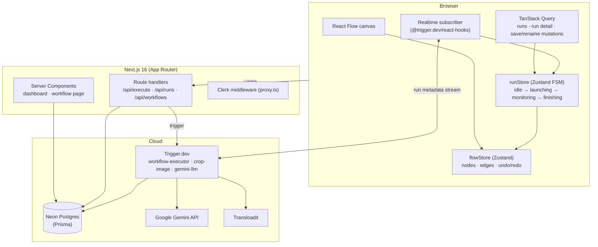

<div align="center">

# ⚡ NextFlow

**A full-stack, real-time, DAG-based AI workflow builder.**

Design, execute, and monitor LLM + image-processing pipelines on a drag-and-drop canvas — powered by Google Gemini, durable background jobs, and live execution streaming.

[Features](#-features) · [Architecture](#-architecture) · [Quick Start](#-quick-start) · [Tech Decisions](#-technical-decisions) · [Docs](./docs)

</div>

---

## ✨ Features

| | |
|---|---|
| 🎨 **Visual canvas** | Drag-and-drop DAG editor built on React Flow v12 — dot-grid, minimap, undo/redo (50 states), autosave |
| 🔌 **Typed connections** | Handles and edges are color-coded by data type (text / image / any); invalid connections are rejected at drag time |
| 🚀 **Concurrent DAG execution** | Topological sort + per-node promise graph: independent branches run in parallel, children fire the instant their parents resolve |
| ⏱️ **Durable background runs** | Trigger.dev v4 tasks survive serverless timeouts; a 30-second checkpointed delay in the crop task demonstrates suspend/resume |
| 📡 **Live status streaming** | Node statuses stream to the canvas via Trigger.dev Realtime (run metadata), with DB polling as the resilient fallback |
| 🤖 **Gemini integration** | Multi-model dropdown (3.1 Pro → 2.5 Pro → 2.5 Flash fallback chain), system prompts, multi-image vision inputs |
| ✂️ **FFmpeg image cropping** | Percentage-based crops executed with FFmpeg in the task runtime, results uploaded to Transloadit |
| 🗂️ **Run history** | Collapsible panel with per-run, per-node inputs/outputs/errors and durations — state shareable via URL |
| 📦 **Import / Export** | Workflows round-trip as JSON blueprints |
| 🔐 **Multi-tenant auth** | Clerk authentication; every query and mutation is scoped to the signed-in user |

## 🧱 Tech Stack

| Layer | Technology | Why |
|---|---|---|
| Framework | **Next.js 16** (App Router, RSC) | Server components + `loading.tsx` + `Suspense` streaming give instant navigation feedback |
| UI | **React 19**, **Tailwind CSS v4**, **React Compiler** | `use()`, `useOptimistic`, `useTransition`; compiler removes manual memoization |
| Canvas | **@xyflow/react 12** | The de-facto React DAG canvas; custom nodes/edges/handles |
| Client state | **Zustand 5** | Two stores: graph state + a run-lifecycle finite state machine |
| Server state | **TanStack Query 5** | Single owner of fetched data; declarative polling driven by the FSM |
| Jobs | **Trigger.dev v4** | Durable, observable task runs with realtime metadata streaming |
| Database | **Neon Postgres** + **Prisma 6** | Serverless-friendly Postgres; JSON columns for graph snapshots |
| Auth | **Clerk** | Drop-in auth with App Router middleware (`src/proxy.ts`) |
| AI | **Google Gemini** (`@google/generative-ai`) | Text + multimodal vision generation |
| Uploads | **Uppy + Transloadit** | Client-side image uploads with a base64 fallback |
| Validation | **Zod 4** | Schema validation for API payloads and task payloads |

## 🏗 Architecture



### Execution model

1. `POST /api/execute` creates a `WorkflowRun` + pending `NodeRun` rows, then triggers the **workflow-executor** task.
2. The executor topologically sorts the graph and builds a **per-node promise DAG** — every node runs the moment all of its parents resolve; unrelated branches never block each other. Failed parents mark downstream nodes `skipped`.
3. Per-node progress is published as Trigger.dev **run metadata** (`node:<id>` keys). The client subscribes with `useRealtimeRun` using a run-scoped public token.
4. Statuses render from a **monotonic ledger** in `runStore` (idle < pending < running < terminal — never downgrade), fed by three writers: optimistic seeds, realtime hints, and the DB poll. **Only the DB poll writes outputs.**
5. Scoped runs (`single`/`partial`) execute only target nodes; upstream values come from cached `node.data.output`.

Full details: [docs/state-management.md](./docs/state-management.md) · [docs/trigger-dev.md](./docs/trigger-dev.md)

### Rendering model

Every page is dynamically server-rendered (auth makes them per-user), but **streamed**:

- Route-level `loading.tsx` shells paint instantly on navigation (prefetched by `<Link>`).
- Slow data (workflow list, run history) streams into nested `Suspense` boundaries — the dashboard shell and editor canvas never wait for it.
- The run-history query is passed to the client as an **unawaited promise** consumed with React 19 `use()`.

Full details: [docs/nextjs.md](./docs/nextjs.md)

## 🗄 Database

Three models, managed with `prisma db push` (no migrations directory — schema-first iteration during the build phase):

```
Workflow      — id, userId, name, nodes (Json), edges (Json), viewport (Json?), status
WorkflowRun   — id, workflowId, userId, status, scope, targetNodes, triggerRunId, duration, timestamps
NodeRun       — id, runId, nodeId, nodeName, nodeType, status, inputs, output, error, duration, timestamps
```

Key choices — JSON graph snapshots instead of normalized node/edge tables, `triggerRunId` on the run row for realtime re-subscription, indexes on `userId`/`workflowId`/`startedAt`. Rationale in [docs/database.md](./docs/database.md).

## 🚀 Quick Start

### Prerequisites

- Node 20+, **pnpm** (`pnpm-workspace.yaml` is present — use pnpm, not npm)
- Accounts: [Neon](https://neon.tech), [Clerk](https://clerk.com), [Trigger.dev](https://trigger.dev), [Google AI Studio](https://aistudio.google.com), [Transloadit](https://transloadit.com) (optional)

### 1. Install & configure

```bash
pnpm install
cp .env.example .env.local   # then fill in the keys below
```

### 2. Push the schema

```bash
npx prisma generate
npx prisma db push
```

### 3. Run (two terminals)

```bash
# Terminal 1 — background task runtime
npx trigger.dev@4 dev

# Terminal 2 — the app
pnpm dev
```

Open http://localhost:3000 — sign in, and the dashboard seeds a sample workflow on first visit.

### 4. Verify a production build

```bash
npx tsc --noEmit && pnpm lint && pnpm build
```

### Deploy

- **App** → Vercel (set all env vars; `proxy.ts` runs as middleware).
- **Tasks** → `npx trigger.dev@4 deploy` (set `DATABASE_URL`, `GOOGLE_AI_API_KEY`, `TRANSLOADIT_*` in the Trigger.dev environment; the FFmpeg build extension is configured in `trigger.config.ts`).

## 🧠 Technical Decisions

The decisions that shaped the codebase, each documented in depth in [`docs/`](./docs):

| Decision | Choice | Over | Why |
|---|---|---|---|
| Run lifecycle | Hand-rolled Zustand FSM (4 phases, 7 events) | XState | One small machine; the hard bugs needed a write ledger + declarative polling, which no FSM library provides |
| Node status writes | Monotonic per-run ledger, single output writer | "last write wins" | Realtime and polling race each other; the ledger makes stale downgrades unrepresentable |
| Server state | TanStack Query, polling derived from FSM phase | `useEffect` + `setInterval` | "Poll never started" and backgrounded-tab hangs become impossible (`refetchIntervalInBackground`) |
| Execution | Per-node promise DAG inside one executor task | `triggerAndWait` per node | Wait checkpoints can't run under concurrent promise fan-out; one task = simpler state, fewer cold starts |
| Realtime | Run metadata + scoped public token | WebSocket server / SSE route | Zero infra; falls back to polling transparently |
| Persisted run state | Executor is the **sole** writer of statuses/outputs | client autosave persisting everything | Kills the autosave-vs-completion race structurally; client strips runtime fields before PATCH |
| Graph storage | JSON columns | normalized tables | Graphs load/save atomically with the canvas; runs are the queryable history |
| Navigation | `<Link>` prefetch + `loading.tsx` + streamed `Suspense` | `router.push` everywhere | Prefetch makes loaders instant; promises stream below the shell |
| Panel UI state | URL query params (`?hide-runs=true`) via a shallow-routing hook | `useState` | Survives reload, shareable, no server roundtrip on toggle |
| Self-healing | Executor `onFailure` hook + stale-run reaper on read paths | cron cleanup | Stuck "running" runs heal on the next poll the user already makes |

## 📁 Project Structure

```
src/
├── app/
│   ├── dashboard/            # RSC dashboard + server actions + streaming workflow list
│   ├── workflow/[id]/        # Editor page: canvas + streamed run history
│   ├── api/                  # execute · runs · workflows · import · trigger-token
│   └── sign-in, sign-up/     # Clerk pages
├── components/
│   ├── nodes/                # RequestInputs · CropImage · Gemini · Response (+ shared)
│   ├── edges/                # AnimatedEdge
│   └── toolbar/              # BottomToolbar · NodePicker
├── stores/                   # flowStore (graph) · runStore (FSM + ledger)
├── lib/                      # queries · query-client · dag · run-reaper · transloadit …
├── hooks/                    # useWorkflowRun · useAutosave · useUrlState
├── trigger/                  # workflow-executor · crop-image · gemini-llm
├── validators/               # Zod schemas
└── proxy.ts                  # Clerk middleware (Next 16 convention)
```

## 📚 Documentation

| Doc | Contents |
|---|---|
| [docs/nextjs.md](./docs/nextjs.md) | App Router patterns: RSC, streaming, `use()`, prefetching, server actions, React Compiler |
| [docs/state-management.md](./docs/state-management.md) | Zustand FSM, the monotonic ledger, TanStack Query design |
| [docs/react-flow.md](./docs/react-flow.md) | Custom nodes/edges/handles, typed connections, undo/redo, viewport persistence |
| [docs/trigger-dev.md](./docs/trigger-dev.md) | The DAG executor, realtime metadata, crop/Gemini tasks, build config |
| [docs/database.md](./docs/database.md) | Schema design, Neon adapter, JSON columns, write-ownership rules |
| [docs/auth.md](./docs/auth.md) | Clerk setup, route protection, per-user data scoping |
| [docs/integrations.md](./docs/integrations.md) | Gemini fallback chain, Transloadit/Uppy uploads, FFmpeg |
| [docs/JOURNEY.md](./docs/JOURNEY.md) | The build log: mistakes made, refactors, and what we learned |

## 📄 License

Private — built as a product-engineering trial project.
